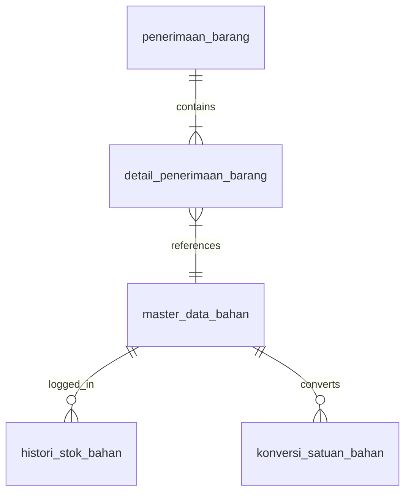
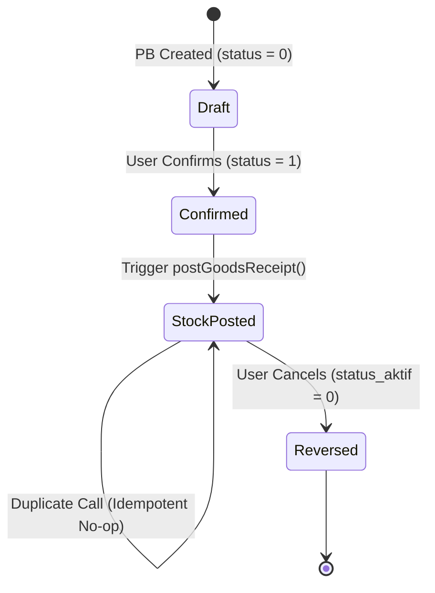

# Goods Receipt Stock Posting Architecture

## Impact Furniture v2 ERP

---

### 1. Database Alignment

Sistem mengacu pada skema database aktual `u1573701_smm.sql` dengan relasi berikut:

### 2. Posting Lifecycle & Idempotency

### 3. Key Technical Invariants

1. **Unit Basis**: Saldo `master_data_bahan.qty` selalu disimpan dalam unit `satuan_pakai_id`.
2. **Konversi Satuan**: Apabila bahan dibeli dalam unit `satuan_beli_id` (misal 1 Dus = 10 Lembar), kuantitas fisik yang ditambahkan ke stok dikalikan faktor konversi dari `konversi_satuan_bahan`.
3. **Kartu Stok (`histori_stok_bahan`)**:
   - Mutasi Masuk: `masuk = qty_terima * conversion_factor`, `keluar = 0`, `tbl = 'penerimaan_barang'`.
   - Mutasi Reversal: `masuk = 0`, `keluar = qty_terima * conversion_factor`, `keterangan = CONCAT("Batal data bahan ", kode)`.
