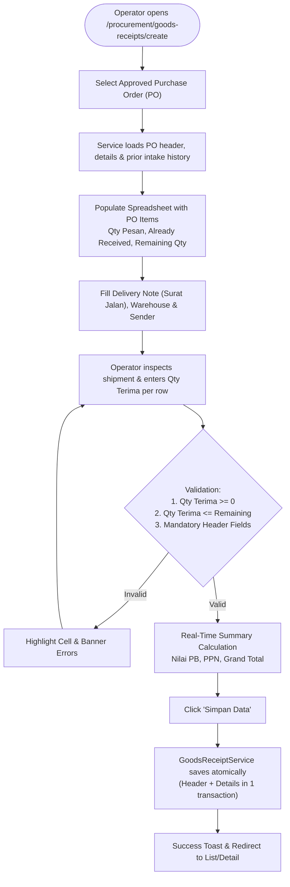

# GOODS RECEIPT (PENERIMAAN BARANG) WORKFLOW SPECIFICATION

## 1. Overview

The Goods Receipt module manages the physical intake and verification of raw materials delivered by suppliers against previously approved Purchase Orders. It enforces partial receipt rules, prevents over-receipt beyond unreceived balance, maintains document audit trails, and provides a safe boundary for subsequent stock ledger updates.

---

## 2. End-to-End Workflow Diagram

---

## 3. Partial Receipts & Remaining Quantity Math

A Purchase Order may be delivered in multiple installments over time. When receiving items for a PO:

1. The service scans all active Penerimaan Barang (`status_aktif === 1`) linked to the selected PO, excluding the current document if editing.
2. For each ordered material:
   $$
   \text{AlreadyReceived} = \sum \text{QtyTerima}_{\text{prior PBs}}
   $$
   $$
   \text{RemainingQty} = \max\left(0, \text{QtyPesan} - \text{AlreadyReceived}\right)
   $$
3. By default, `qty_terima` initializes to $\text{RemainingQty}$ so the operator can receive the remaining balance in 1 click, or adjust it downwards for partial shipments.
4. Validation rule:
   $$
   0 \le \text{QtyTerima} \le \text{RemainingQty}
   $$
   Any input where $\text{QtyTerima} > \text{RemainingQty}$ triggers an immediate per-cell error and blocks submission.

---

## 4. Stock Integration Boundary

- Goods Receipt physical intake verifies incoming materials into the assigned warehouse (`gudang_id`).
- In this phase (Task 6 & 7), mutations to `master_data_bahan.qty` and stock card records (`histori_stok_bahan`) are managed through an explicit service boundary to prevent duplicate stock increments between unverified drafts and approved receipts.
- Stock posting is staged for coordinated execution with inventory ledgers in subsequent tasks.
