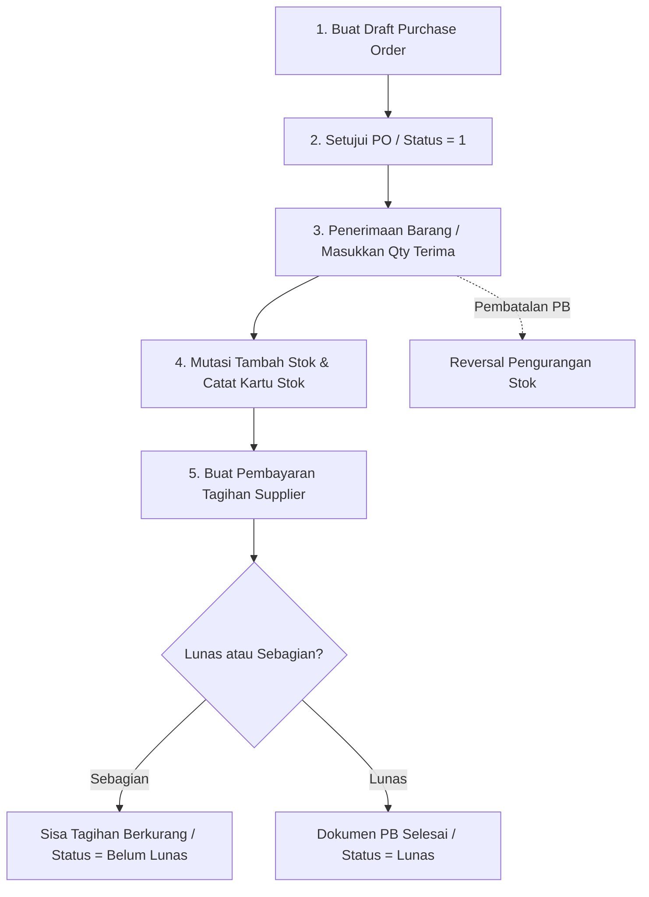

# Procurement Workflow & Business Lifecycle

## Impact Furniture v2 ERP

---

### Business Rules & Guardrails

1. **PO Terkunci**: Purchase Order yang sudah disetujui (`status = 1`) tidak dapat dihapus jika telah memiliki dokumen Penerimaan Barang.
2. **Kuantitas Parsial**: Penerimaan barang tidak dapat menerima lebih dari sisa kuantitas pesanan PO ($\text{qty\_terima} \le \text{sisa\_po}$).
3. **Double Posting Prevention**: Dokumen PB yang telah diposting tidak akan menambahkan stok untuk kedua kalinya.
4. **Overpayment Prevention**: Jumlah nominal pembayaran tidak dapat melampaui sisa tagihan dokumen Penerimaan Barang.
