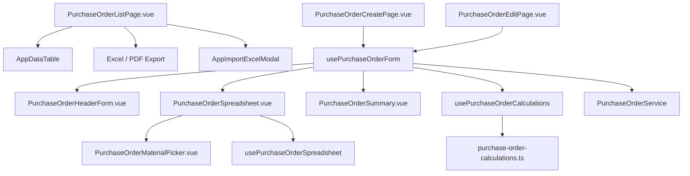

# PURCHASE ORDER ARCHITECTURE SPECIFICATION

## 1. Architectural Philosophy

The Procurement Purchase Order module follows the modular Feature-Sliced design pattern implemented across Impact Furniture v2. It isolates domain logic, calculation rules, presentation components, composables, and mock data services while integrating seamlessly with the central router, pinia auth store, and shared UI component library.

```
app/src/modules/procurement/purchase-orders/
├── components/
│   ├── PurchaseOrderHeaderForm.vue        # Section A: Header two-column form
│   ├── PurchaseOrderMaterialPicker.vue    # Double-click floating material search
│   ├── PurchaseOrderSpreadsheet.vue       # Section B: Desktop tabular spreadsheet grid
│   ├── PurchaseOrderStatusBadge.vue       # Status, PPN, and transaction badges
│   └── PurchaseOrderSummary.vue           # Section C: Real-time calculation summary
├── composables/
│   ├── usePurchaseOrderCalculations.ts    # Live subtotal & document summary reactivity
│   ├── usePurchaseOrderForm.ts            # Form lifecycle, save orchestration & dirty tracking
│   └── usePurchaseOrderSpreadsheet.ts     # Grid row management, active cell, keyboard navigation
├── mocks/
│   └── purchase-orders.mock.ts            # Seeded PO headers, line details, and lookup fixtures
├── services/
│   └── purchase-order.service.ts          # Mock repository with atomic rollback & CRUD
├── types/
│   └── purchase-order.types.ts            # Strict domain contracts matching legacy schema
├── utils/
│   ├── purchase-order-calculations.ts     # Decimal-safe arithmetic calculation engine
│   ├── purchase-order-import.config.ts    # Excel batch template and row mapper
│   └── purchase-order-validation.ts       # Header & line validation rules
└── views/
    ├── PurchaseOrderListPage.vue          # DataTable list with multi-filters, export & import
    ├── PurchaseOrderCreatePage.vue        # Full-page create view
    └── PurchaseOrderEditPage.vue          # Full-page edit view
```

---

## 2. Component Hierarchy & Data Flow



---

## 3. Core Composables

### 3.1 `usePurchaseOrderForm`

- **Responsibilities**:
  - Initializes header state and detail row array.
  - Automatically fetches lookup datasets (Suppliers, Materials, Units, Active PPN).
  - Handles auto-code generation (`generateCode()`).
  - Tracks pristine state snapshot to detect unsaved changes (`isDirty`).
  - Orchestrates validation, cleans empty rows, constructs create/update payload, and invokes `PurchaseOrderService`.

### 3.2 `usePurchaseOrderSpreadsheet`

- **Responsibilities**:
  - Manages row operations: adding lines, removing lines, updating cell values, clearing empty rows.
  - Controls active cell coordinates `(rowIndex, columnKey)`.
  - Controls double-click material picker visibility, popover screen positioning, and focus handover.
  - Provides keyboard navigation handlers for Tab, Shift+Tab, Arrow keys, Enter, and Delete.

### 3.3 `usePurchaseOrderCalculations`

- **Responsibilities**:
  - Reactive bridge between spreadsheet rows, header discount/tax settings, and calculation engine.
  - Computes `itemCount`, `totalQty`, `subtotal`, `diskonNominal`, `totalSebelumPpn`, `ppnNominal`, and `totalBayar` synchronously on any input change.

---

## 4. Mock Service & Atomic Rollback Mechanism

The `PurchaseOrderService` simulates a real backend API and MariaDB storage using in-memory state:

- Maintains separate collections for `purchase_orders` and `detail_purchase_orders`.
- **Atomic Operations**:
  - When creating or updating a Purchase Order, snapshots of both collections are captured before applying mutations.
  - If detail validation or foreign key resolution fails, the service performs an immediate rollback to the snapshot state, ensuring no orphaned headers or detached line items persist.
- **Delete Safeguards**:
  - Purchase Orders with `status === 1` (Disetujui / Approved) are strictly protected against deletion. Attempts to delete approved POs throw a business exception with a user-facing error message.

---

## 5. Route Integration & Role-Based Access Control (RBAC)

Routes are declared in `app/src/app/router/routes.ts`:

- `/procurement/purchase-orders`: requires `procurement:read`.
- `/procurement/purchase-orders/create`: requires `procurement:create`.
- `/procurement/purchase-orders/:id/edit`: requires `procurement:update`.
- All routes inherit `onBeforeRouteLeave` dirty checks to protect against unsaved form abandonment.
