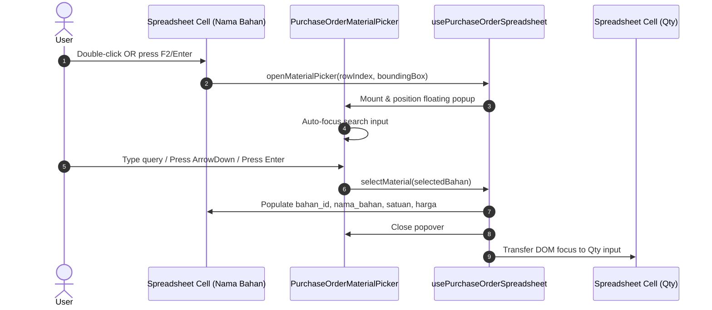

# PURCHASE ORDER SPREADSHEET EDITOR SPECIFICATION

## 1. Executive Summary & Library Evaluation

In accordance with Sprint 4 specifications, the Procurement Purchase Order detail input requires a high-density, desktop-style spreadsheet experience replicating the ergonomics of the legacy desktop system while utilizing modern web standards.

### Evaluation of Options:

1. **Handsontable**:
   - Pros: Rich Excel-like feature set.
   - Cons: Strict commercial license requirements (GPL/Commercial paywall), heavy bundle size, potential legal/compliance risks.
2. **AG Grid Community**:
   - Pros: Strong grid capabilities.
   - Cons: Large bundle footprint (>1.2MB), excessive DOM complexity for standard transactional sub-forms, styling friction with Tailwind CSS and Inter typography.
3. **Dedicated Native Vue 3 Spreadsheet Component (`PurchaseOrderSpreadsheet.vue`) [SELECTED]**:
   - **Zero Licensing Risk**: 100% custom code under project ownership.
   - **Zero Extra Bundle Overhead**: Uses existing Vue 3 Composition API and Tailwind CSS primitives.
   - **Design System Fidelity**: Inherits exact design tokens (`#34454F`, `#0F766E`, `#D9E0E7`, Inter typography).
   - **High Ergonomic Control**: Custom keyboard navigation, double-click material popup, and auto-focus transitions.

---

## 2. Interaction Design & User Experience

### 2.1 Initial 10-Row Template

- On loading `PurchaseOrderCreatePage`, the spreadsheet initializes with 10 empty rows numbered 1 through 10.
- Operators can immediately click or navigate into any cell and start typing without needing to manually click "Tambah Baris" first.
- When saving, `usePurchaseOrderForm` automatically strips rows where `bahan_id` is null, ensuring pristine payloads without blank noise.

### 2.2 Material Selector Popover Interaction Flow

### 2.3 Keyboard Shortcut Matrix

| Key Combination         | Scope / Context         | Action                                                                                                                                   |
| :---------------------- | :---------------------- | :--------------------------------------------------------------------------------------------------------------------------------------- |
| `Tab`                   | Any cell input          | Commit current value and move focus to next editable column. If at the end of a row, moves to the first editable column of the next row. |
| `Shift + Tab`           | Any cell input          | Move focus to previous editable column.                                                                                                  |
| `Arrow Up`              | Any cell input          | Move focus to corresponding column in previous row.                                                                                      |
| `Arrow Down`            | Any cell input          | Move focus to corresponding column in next row.                                                                                          |
| `Enter` (Nama Bahan)    | Nama Bahan cell         | Opens material picker popover.                                                                                                           |
| `Enter` (Numeric cells) | Qty, Harga, Diskon      | Commits value and moves focus downward or to next logical field.                                                                         |
| `Escape`                | Material Picker popover | Closes material picker without modifying row.                                                                                            |
| `Arrow Up / Down`       | Material Picker search  | Navigates candidate list items.                                                                                                          |
| `Enter`                 | Material Picker list    | Confirms selection and transfers focus to `Qty`.                                                                                         |

---

## 3. Cell Structure & Formatting Rules

| Column | Header                   | Type              | Alignment | Behavior / Formatting                                                                        |
| :----- | :----------------------- | :---------------- | :-------- | :------------------------------------------------------------------------------------------- |
| 1      | `No`                     | Index             | Center    | Static 1-based index badge                                                                   |
| 2      | `Nama Bahan / Deskripsi` | Button / Select   | Left      | Truncated text; placeholder "Klik dua kali untuk memilih bahan..."; badge indicator on hover |
| 3      | `Satuan`                 | Readonly          | Center    | Auto-populated badge from `satuan.nama`                                                      |
| 4      | `Stok Gudang`            | Readonly          | Right     | Stock availability indicator with low-stock badge styling                                    |
| 5      | `Qty`                    | Number input      | Right     | Positive numeric value; minimum 0.001                                                        |
| 6      | `Harga Satuan`           | Number input      | Right     | Currency input; automatically defaults to `bahan.harga_beli`                                 |
| 7      | `Diskon (%)`             | Number input      | Right     | Percentage value constrained between 0 and 100                                               |
| 8      | `Subtotal`               | Readonly Computed | Right     | Bold formatted currency text: `Qty * Harga * (1 - Diskon/100)`                               |
| 9      | `Keterangan`             | Text input        | Left      | Optional line remarks / instructions                                                         |
| 10     | `Aksi`                   | Action button     | Center    | Trash icon button to delete line                                                             |
