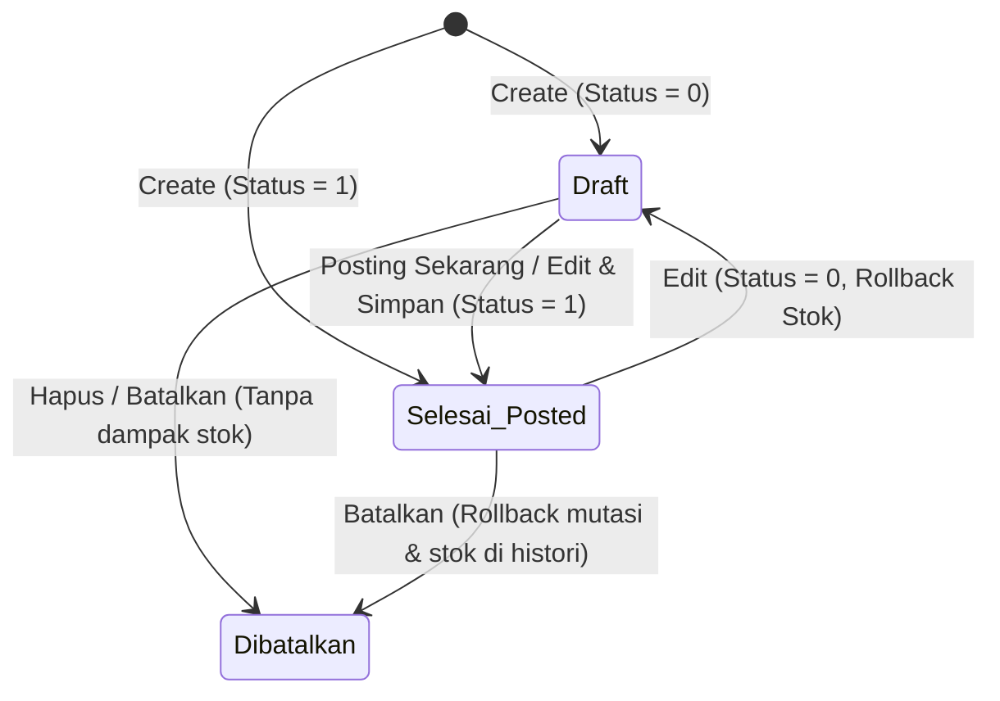

# Sprint 5 — Fitur 2: Penyesuaian Stok Bahan Stock Workflow & Ledger Integration

## 1. Alur Transaksi & State Machine

---

## 2. Logika Posting & Integrasi `stockPostingService`

Setiap kali transaksi penyesuaian berpindah ke status `1` (Selesai):

1. **Pemeriksaan Idempotensi**:
   - `postedAdjustmentIds: Set<number>` memeriksa apakah dokumen ID ini sudah pernah diposting untuk menghindari double-deduction.
2. **Kalkulasi Selisih**:
   - $\text{Selisih} = \text{stok\_akhir} - \text{stok\_awal}$
3. **Pencatatan Buku Besar**:
   - **Jika Selisih $> 0$ (Surplus)**:
     - `masuk` = $\text{Selisih}$
     - `keluar` = $0$
     - `targetMat.qty += Selisih`
   - **Jika Selisih $< 0$ (Susut/Defisit)**:
     - `masuk` = $0$
     - `keluar` = $|\text{Selisih}|$
     - `targetMat.qty -= |\text{Selisih}|`
   - **Jika Selisih $= 0$**:
     - Tidak ada mutasi persediaan yang perlu dicatat.
4. **Metadata Audit**:
   - `tbl = 'penyesuaian_stok'`
   - `tbl_id = adjustment.id`
   - `kode = adjustment.kode`
   - `tanggal = adjustment.tanggal`
   - `keterangan = 'Penyesuaian stok ' + kode + ' - ' + tanggal`

---

## 3. Reversal & Rollback Saat Pembatalan

Jika dokumen berstatus `1` dihapus atau dibatalkan:

1. `stockPostingService.reverseStockAdjustment(adjustmentId)` dipanggil.
2. Setiap detail diperiksa:
   - Jika dahulu surplus ($\text{Selisih} > 0$), maka sekarang dikeluarkan: `targetMat.qty -= Selisih`, dicatat sebagai entri keluar di histori.
   - Jika dahulu susut ($\text{Selisih} < 0$), maka sekarang dikembalikan: `targetMat.qty += |\text{Selisih}|`, dicatat sebagai entri masuk di histori dengan keterangan `'Batal Penyesuaian stok ...'`.
3. Dokumen ditandai `status_aktif = 0` (soft delete) sehingga audit trail tetap terjaga.
