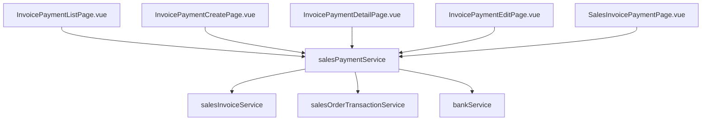

# Sprint 7 — Arsitektur & Service Layer: Pembayaran Sales Invoice

## 1. Prinsip Single Source of Truth

Modul Pembayaran Sales Invoice dirancang dengan arsitektur **Single Source of Truth** agar tidak terjadi inkonsistensi saldo antara tampilan invoice per-SO dengan modul mandiri _Pembayaran Invoice_.

- `salesPaymentService`: Bertanggung jawab atas seluruh siklus hidup transaksi pembayaran, validasi batas nominal pembayaran, pembuatan kode pembayaran unik (`PAY/...`), sinkronisasi otomatis ke invoice dan sales order, serta pembatalan (_reversal_).
- `salesInvoiceService`: Mengelola dokumen tagihan (invoice), kalkulasi pajak PPN (khusus SO Impact), dan pelacakan status pembayaran invoice (`BELUM_BAYAR`, `SEBAGIAN`, `LUNAS`).
- `salesOrderTransactionService`: Menyimpan header dan detail Sales Order, mencatat audit trail ke `histori_table`, dan mengagregasi total pembayaran terakumulasi pada level order.

---

## 2. Struktur Routing & Navigasi

Submenu pada navigasi modul **Penjualan**:

1. `SO Impact` (`/sales/orders/impact`)
2. `SO Pola` (`/sales/orders/pola`)
3. `SO KS` (`/sales/orders/ks`)
4. **`Pembayaran Invoice` (`/sales/invoice-payments`)**

### Rute Halaman

| URL                                   | Rute Name                       | Komponen                       | Fungsi                                                 |
| ------------------------------------- | ------------------------------- | ------------------------------ | ------------------------------------------------------ |
| `/sales/invoice-payments`             | `sales-invoice-payments`        | `InvoicePaymentListPage.vue`   | Daftar Tagihan (Mode A) & Riwayat Transaksi (Mode B)   |
| `/sales/invoice-payments/create`      | `sales-invoice-payments-create` | `InvoicePaymentCreatePage.vue` | Form catat pembayaran dengan Searchable Invoice Picker |
| `/sales/invoice-payments/:id`         | `sales-invoice-payments-detail` | `InvoicePaymentDetailPage.vue` | Detail voucher pembayaran, relasi invoice, kuitansi    |
| `/sales/invoice-payments/:id/edit`    | `sales-invoice-payments-edit`   | `InvoicePaymentEditPage.vue`   | Koreksi pembayaran (jika belum diposting ke finance)   |
| `/sales/invoices/:invoiceId/payments` | `sales-invoice-payments-direct` | `SalesInvoicePaymentPage.vue`  | Riwayat pembayaran per-invoice spesifik                |

---

## 3. Isolasi Varian Dokumen

Sistem secara konsisten mempertahankan metadata varian (`impact`, `pola`, `ks`) pada setiap entitas invoice dan pembayaran:

- **SO Impact**: Mengikutsertakan PPN 11% (atau tarif aktif) pada tahap penerbitan invoice. Saat pembayaran dilakukan, nominal yang dibayarkan adalah nominal kotor (Gross IDR) dan **tidak dilakukan rekalkulasi pajak**.
- **SO Pola**: Non-PPN, nominal invoice murni Dasar Pengenaan Pajak (DPP).
- **SO KS**: Non-PPN varian 2, penomoran dan pembukuan terisolasi.
- Label, badge warna, dan kuitansi otomatis menyesuaikan kop surat perusahaan berdasarkan varian dokumen:
  - Impact: PT Impact Pratama Furniture (Teal)
  - Pola: CV Pola Kayu / Polaris Furniture (Blue)
  - KS: CV Karya Santosa (Purple)
