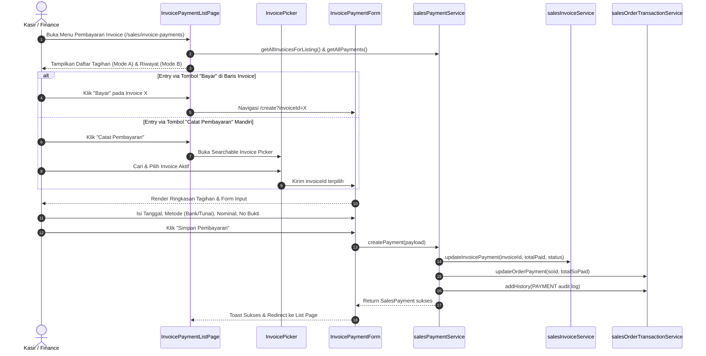

# Sprint 7 — Alur Kerja & Workflow Pembayaran Sales Invoice

## 1. Alur Transaksi End-to-End

---

## 2. Alur Pembatalan Pembayaran (Payment Reversal)

Jika kasir melakukan kesalahan pencatatan atau dana bilyet giro/transfer ditolak oleh pihak perbankan, kasir dapat melakukan aksi pembatalan:

1. **Syarat Pembatalan**:
   - `payment.status === 1` (transaksi masih aktif).
   - `payment.is_posted_to_finance === false` (belum terkunci oleh tutup buku modul Keuangan).
2. **Langkah Reversal**:
   - Pengguna menekan tombol icon **Batal** (`XCircle`).
   - Sistem membuka dialog konfirmasi `AppConfirmDialog` dengan input wajib **Alasan Pembatalan**.
   - Saat disetujui, `salesPaymentService.cancelPayment(id, reason)` dieksekusi:
     - `payment.status` diubah menjadi `0` (Dibatalkan).
     - `payment.alasan_batal` dan timestamp pembatalan dicatat.
     - Saldo `terbayar` invoice dikurangi sebesar nominal yang dibatalkan, status tagihan invoice kembali menjadi `SEBAGIAN` atau `BELUM_BAYAR`.
     - Saldo `terbayar` pada Sales Order disinkronkan kembali.
     - Jejak audit `PAYMENT_CANCEL` dicatat permanen ke `histori_table`.
