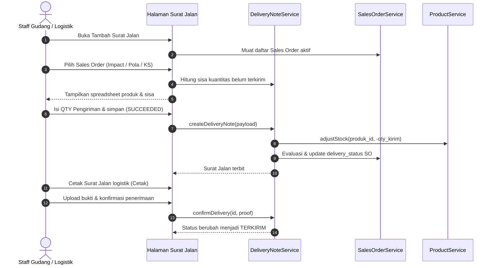

# SPRINT 7 — SURAT JALAN & PENGIRIMAN: WORKFLOW & STATUS LIFECYCLE

## 1. Siklus Hidup Dokumen & Status Pengiriman

Modul Pengiriman memiliki dua status independen yang mencerminkan status hukum dokumen dan status fisik barang:

```
[STATUS DOKUMEN]
  DRAFT (0) ──────► SUCCEEDED (1) ──────► BATAL (2)
                     (Sah / Siap Kirim)    (Dibatalkan / Void)

[STATUS PENGIRIMAN]
  BELUM DIKIRIM (0) ──────► TERKIRIM (1)
          │
          └───────────────► AMBIL SENDIRI (2)
```

### Tabel Status Transisi:

| Status Dokumen    | Status Kirim      | Metode        | Efek Stok                   | Status SO Terkait                                   |
| ----------------- | ----------------- | ------------- | --------------------------- | --------------------------------------------------- |
| **DRAFT (0)**     | BELUM DIKIRIM (0) | Dikirim       | Belum berkurang             | BELUM_KIRIM                                         |
| **SUCCEEDED (1)** | BELUM DIKIRIM (0) | Dikirim       | **Berkurang**               | BELUM_KIRIM (jika parsial) / TERKIRIM (jika tuntas) |
| **SUCCEEDED (1)** | TERKIRIM (1)      | Dikirim       | **Berkurang**               | TERKIRIM (jika seluruh pesanan telah terkirim)      |
| **SUCCEEDED (1)** | AMBIL SENDIRI (2) | Ambil Sendiri | **Berkurang**               | TERKIRIM (jika seluruh pesanan telah terambil)      |
| **BATAL (2)**     | -                 | -             | **Dikembalikan (Reversal)** | Revert ke BELUM_KIRIM                               |

---

## 2. Alur Transaksi End-to-End


