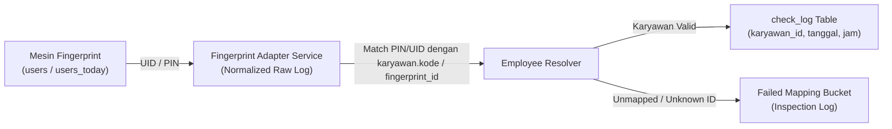

# Sprint 8 — Presensi Fingerprint Device Mapping

## 1. Overview & Alur Pemetaan Perangkat
Modul Presensi menjembatani data mentah (*raw fingerprint log*) yang dihasilkan oleh mesin absensi fisik (Solution/ZKTeco) dengan entitas karyawan dalam database perusahaan.

## 2. Struktur Data Mentah (*Raw Record*)
Pada antarmuka API / SDK mesin fingerprint legacy:
- `uid`: Integer identifier log pada mesin.
- `id` / `pin`: ID pengguna di mesin yang merepresentasikan kode karyawan (misal `"1"`, `"2"`, `"71"`).
- `timestamp`: Format waktu `"YYYY-MM-DD HH:mm:ss"`.
- `state`: Status log (Check In, Check Out, Break Out, Break In).

## 3. Resolusi Mapping Karyawan
1. **Pencarian Utama**: Mencocokkan `pin` / `uid` dari log mesin dengan field `karyawan.kode` atau `karyawan.id`.
2. **Karyawan Non-Aktif**: Jika ID cocok namun status karyawan non-aktif (`status !== 'active'`), log tetap dicatat atau ditandai sesuai kebutuhan audit tanpa menghalangi sinkronisasi log karyawan aktif.
3. **ID Tidak Dikenali (*Unmapped*)**:
   - Jika `pin` tidak cocok dengan karyawan manapun dalam sistem:
   - Dihitung sebagai `totalFailedMapping`.
   - Log tidak dimasukkan ke dalam `check_log` agar integritas relasi `karyawan_id` tidak terlanggar.
   - Ditampilkan pada tab inspeksi "Data Fingerprint" dengan status "Tidak Terdaftar" berwarna merah.

## 4. Keamanan dan Batasan Arsitektural
- Frontend Vue 3 **TIDAK PERNAH** melakukan koneksi socket TCP atau UDP langsung dari browser ke IP mesin fingerprint (karena pembatasan CORS dan sandboxing browser).
- Frontend berinteraksi melalui service adapter yang mensimulasikan protokol sinkronisasi endpoint backend.
- Format waktu dan ID tidak diubah secara destruktif selama proses pemetaan.

