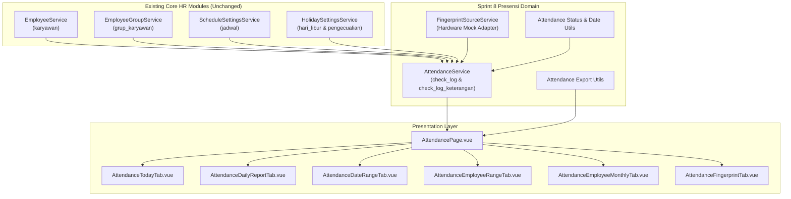

# Sprint 8 — Presensi Integration Architecture & Safety

## 1. Arsitektur Integrasi Modul HR
Modul Presensi V2 dibangun di atas fondasi domain HR yang telah ada dengan prinsip isolasi modul dan perlindungan kode sumber (*zero-modification contract*):

## 2. Kontrak Kepatuhan (Zero-Modification Contract)
File-file inti HR berikut **TIDAK DIUBAH** sama sekali untuk mencegah regresi:
- `app/src/modules/hr/services/employee.service.ts`
- `app/src/modules/hr/services/employee-group.service.ts`
- `app/src/modules/hr/services/schedule-settings.service.ts`
- `app/src/modules/hr/services/holiday-settings.service.ts`

Seluruh data master (karyawan aktif, kode grup, jam kerja jadwal harian, dan tanggal libur) dibaca secara read-only melalui service masing-masing.

## 3. RBAC & Hak Akses Presensi
- **Routing**: `hr/attendance` didaftarkan di `app/src/app/router/routes.ts` dengan metadata `permission: 'hr:read'`.
- **Aksi Baca (`hr:read`)**:
  - Melihat seluruh tab presensi, tabel kehadiran, ringkasan KPI, dan riwayat karyawan.
  - Mengunduh laporan Excel dan PDF.
- **Aksi Tulis / Sinkronisasi (`hr:create`)**:
  - Tombol *Ambil data fingerprint*, *Ambil data 3 Hari Kebelakang*, *Import data*, dan *Sinkronisasi Data* hanya ditampilkan jika pengguna memiliki izin `hr:create`.
- **Aksi Koreksi Keterangan (`hr:update`)**:
  - Tombol *Edit* keterangan pada baris presensi hanya dapat diakses oleh pengguna yang memiliki izin `hr:update`.

