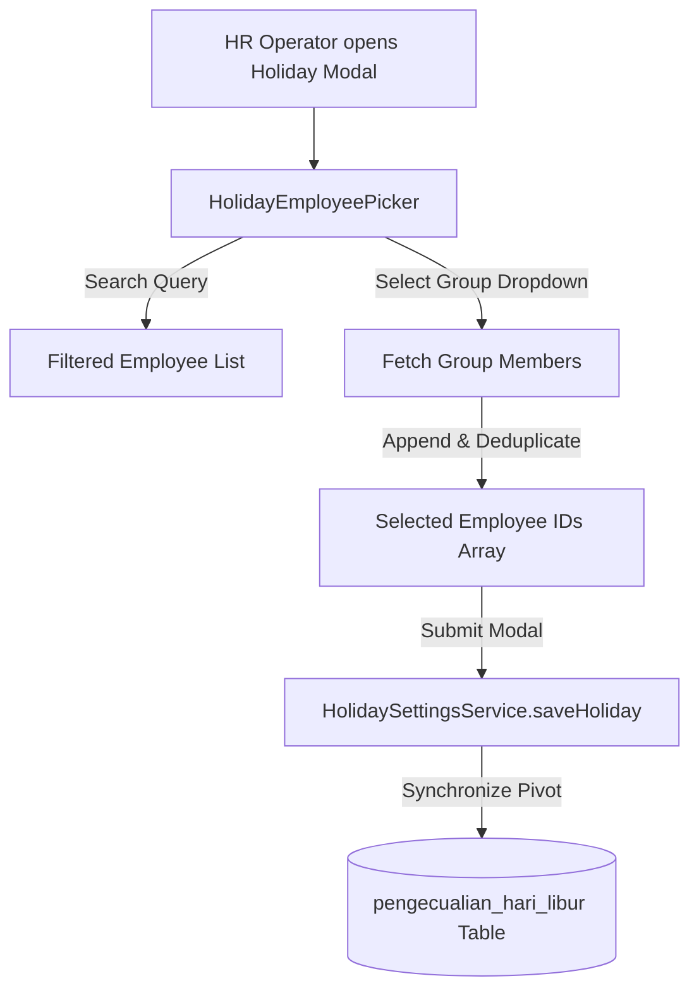

# SPRINT 8 — TASK 10: EMPLOYEE EXCEPTION PICKER & GROUP ASSISTANCE

## 1. Overview

In factory and manufacturing operations, national holidays or Sundays often require specific teams or employees (e.g., security guards, emergency dispatchers, delivery drivers, or maintenance technicians) to remain on duty.

The Employee Exception subsystem provides:

1. Multi-select employee picker with search filtering.
2. Group-assisted quick selection (appending entire group rosters with one click).
3. Compact summary presentation on table views with a full detail modal.

---

## 2. Component Architecture

### 2.1 `HolidayEmployeePicker.vue`

Interactive selection control embedded inside `HolidayFormModal.vue`:

- **Search Filtering**: Real-time filtering by employee name, NIK, or job title (jabatan).
- **Group Filter Dropdown**: Narrow the available list to members of a single employee group.
- **Group-Assisted Selection Dropdown**:
  - Selecting e.g. "Group Satpam" or "Grup Driver Achmad" immediately appends all active members of that group to the selected array.
  - Automatically deduplicates IDs so an employee already chosen is not duplicated.
- **Quick Selection Controls**:
  - "Pilih Semua yang Tampil": Toggles selection of all employees currently matching the search filter.
  - "Kosongkan" / "Reset": Clears all selected exemptions.
- **Active Selection Preview Chips**:
  - Displays selected employees as compact chips with their assigned group color dot.
  - Clicking "x" removes an individual employee from the selection.

### 2.2 `HolidayExceptionSummary.vue`

Presents the exception status in table rows:

- **Zero Exceptions**: Displays `Semua Libur` with subtle slate badge.
- **1–2 Exceptions**: Displays individual employee names in emerald badges.
- **3+ Exceptions**: Displays first 2 employees plus a clickable `+N lainnya` button.
- **Detail Modal**:
  - Clicking `+N lainnya` or the view icon opens `AppModal` displaying the complete roster of exempted staff with their code, name, job title, and group badges.

---

## 3. Data Flow Diagram

