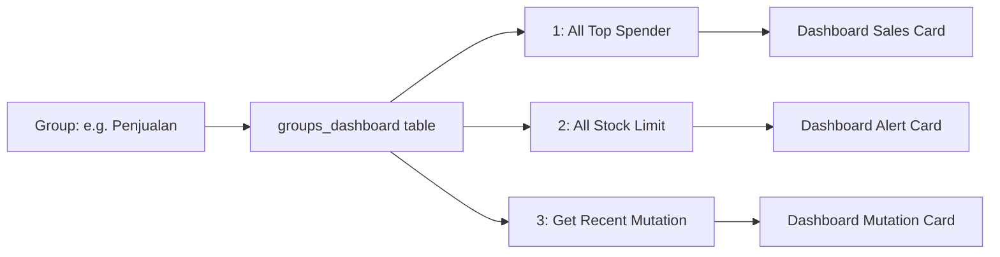

# SPRINT 9 — TASK 1 & 4: DASHBOARD ACCESS REGISTRY & CONFIGURATION

## 1. Overview
In legacy IMPACT FURNITURE (CodeIgniter 3), dashboard widget visibility is controlled per user group via the `groups_dashboard` table. Each group can be assigned specific widgets that populate the main dashboard grid.

---

## 2. Legacy Dashboard Widget Mapping

The legacy database table `dashboard` defines the following 3 verified widgets:

| ID | Legacy Key / Title | Modern Component | Category | Description |
|---|---|---|---|---|
| `1` | `All Top Spender` | `TopSpenderWidget.vue` | Sales / CRM | Displays ranking of top spenders / corporate clients based on completed sales order turnover. |
| `2` | `All Stock Limit` | `StockLimitWidget.vue` | Inventory | Displays inventory stock alerts for raw materials and finished goods that fall below safety stock limits. |
| `3` | `Get Recent Mutation` | `RecentMutationWidget.vue` | Inventory / Audit | Displays a real-time audit feed of recent warehouse stock mutations (in/out/adjustments). |

---

## 3. Component Architecture (`GroupDashboardAccess.vue`)

The dashboard widget permission section is rendered as a clean configuration card above the permission matrix:

### 3.1 Features:
- **Global Toggle / Select All**: Checkbox header that toggles all 3 widgets simultaneously.
- **Indeterminate State Support**: If 1 or 2 widgets are checked, the header checkbox enters an indeterminate (`dash`) state.
- **Widget Details Table**:
  - Checkbox per row.
  - Widget Name & Description.
  - Category Badge (e.g. `Penjualan`, `Persediaan`).
  - Active Status Indicator.
- **Read-Only / Disabled Mode**: When viewing group detail (`GroupDetailPage.vue`), checkboxes are disabled or rendered with read-only badges.

### 3.2 Verification & Fallback Integrity:
- Legacy groups without explicit widget entries default to an empty widget array `[]`.
- Superadmin (`admin`, ID 1) defaults to all 3 widgets enabled `[1, 2, 3]`.
- Existing dashboard components in V2 check `authStore.currentUser.accessibleWidgets` or group assignments to render widgets conditionally.

