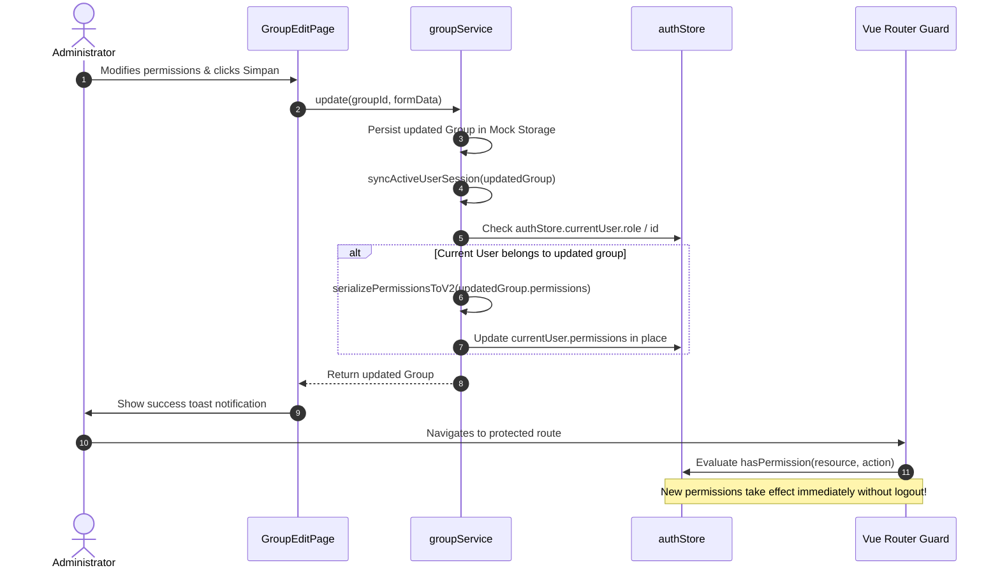

# SPRINT 9 — TASK 1–4: RBAC INTEGRATION & SESSION SYNCHRONIZATION

## 1. Overview
A critical requirement of Sprint 9 is that modifying a group's permissions immediately updates the active session's capabilities without forcing the user to log out and log in again, while preserving existing authentication guards and route RBAC.

---

## 2. Route Configuration & RBAC Guards

The routes are registered in `app/src/app/router/routes.ts`:

```typescript
{
  path: '/system/groups',
  name: 'system-groups-list',
  component: () => import('@/modules/system/groups/pages/GroupListPage.vue'),
  meta: {
    requiresAuth: true,
    title: 'Master Data Groups (Role Access)',
    breadcrumbs: [
      { label: 'System Setting', path: '/system' },
      { label: 'Master Data Groups', path: '/system/groups' }
    ],
    permissions: [{ resource: 'system', action: 'read' }]
  }
},
{
  path: '/system/groups/create',
  name: 'system-groups-create',
  component: () => import('@/modules/system/groups/pages/GroupCreatePage.vue'),
  meta: {
    requiresAuth: true,
    title: 'Tambah Group Baru',
    breadcrumbs: [
      { label: 'System Setting', path: '/system' },
      { label: 'Master Data Groups', path: '/system/groups' },
      { label: 'Tambah Group', path: '/system/groups/create' }
    ],
    permissions: [{ resource: 'system', action: 'create' }]
  }
},
{
  path: '/system/groups/:id',
  name: 'system-groups-detail',
  component: () => import('@/modules/system/groups/pages/GroupDetailPage.vue'),
  meta: {
    requiresAuth: true,
    title: 'Detail Group',
    breadcrumbs: [
      { label: 'System Setting', path: '/system' },
      { label: 'Master Data Groups', path: '/system/groups' },
      { label: 'Detail Group', path: '' }
    ],
    permissions: [{ resource: 'system', action: 'read' }]
  }
},
{
  path: '/system/groups/:id/edit',
  name: 'system-groups-edit',
  component: () => import('@/modules/system/groups/pages/GroupEditPage.vue'),
  meta: {
    requiresAuth: true,
    title: 'Edit Group & Role Access',
    breadcrumbs: [
      { label: 'System Setting', path: '/system' },
      { label: 'Master Data Groups', path: '/system/groups' },
      { label: 'Edit Group', path: '' }
    ],
    permissions: [{ resource: 'system', action: 'update' }]
  }
}
```

---

## 3. Session Synchronization Flow

When an administrator updates a group via `groupService.update(id, form)`:



### Implementation Code (`group.service.ts`):
```typescript
public syncActiveUserSession(group: Group): void {
  try {
    const authStore = useAuthStore();
    if (!authStore.currentUser) return;

    const matchesRole = authStore.currentUser.role.toLowerCase() === group.name.toLowerCase();
    const matchesId = authStore.currentUser.roleId === group.id;

    if (matchesRole || matchesId) {
      const v2Permissions = serializePermissionsToV2(group.permissions);
      authStore.currentUser = {
        ...authStore.currentUser,
        permissions: v2Permissions
      };
    }
  } catch {
    // Isolated in non-pinia / unit test environments
  }
}
```

---

## 4. UI Action Permission Enforcement

In `GroupListPage.vue`, actionable buttons are guarded using `usePermissions`:

| Action | Required Permission | Behavior when Denied |
|---|---|---|
| **Tambah Groups** | `system:create` | Hidden from header toolbar |
| **Aksi → Edit** | `system:update` | Hidden from row dropdown menu |
| **Aksi → Hapus** | `system:delete` | Hidden from row dropdown menu |
| **Aksi → Detail** | `system:read` | Visible to all authorized readers |
| **Export PDF / Excel** | `system:read` | Available to all authorized readers |

---

## 5. Unsaved Changes Guard
Both `GroupCreatePage.vue` and `GroupEditPage.vue` implement `onBeforeRouteLeave`:
- Tracks a dirty state flag (`isDirty`) when inputs or checkboxes differ from initial state.
- Prompts user confirmation if navigating away with unsaved modifications:
  `"Anda memiliki perubahan yang belum disimpan. Yakin ingin meninggalkan halaman ini?"`
- Clears dirty state upon successful submission.

