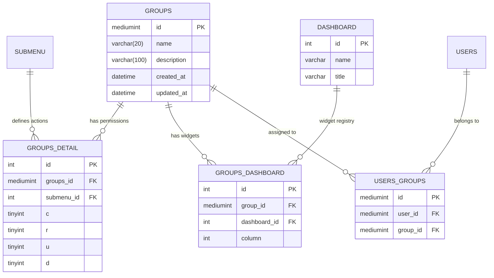

# SPRINT 9 — TASK 1: MASTER DATA GROUPS SCHEMA AUDIT

## 1. Executive Summary
This document provides the definitive architectural schema audit for **Master Data Groups (Role Access)** in IMPACT FURNITURE V2, verified against legacy CodeIgniter 3 files (`application/controllers/admin/Groups.php`, views `add_page.php`, `edit_page.php`, `look_page.php`) and SQL database dump (`u1573701_smm.sql`).

---

## 2. Legacy Database Schema & Relationships

### 2.1 Table: `groups`
Stores the master role/group identity.

| Column | Type | Nullable | Key | Default | Description |
|---|---|---|---|---|---|
| `id` | mediumint(8) unsigned | NO | PRI | AUTO_INCREMENT | Unique Group Identifier |
| `name` | varchar(20) | NO | | | System group code / identifier (e.g. `admin`, `pengadaan`) |
| `description` | varchar(100) | NO | | | Human-readable role description (e.g. `Administrator Sistem`) |
| `created_at` | timestamp / datetime | YES | | NULL / CURRENT_TIMESTAMP | Audit creation timestamp |
| `updated_at` | timestamp / datetime | YES | | NULL | Audit last updated timestamp |

#### Legacy Constraints & Rules:
1. **Name Format**: In legacy PHP view: `strtoupper($field['name'])`. The name is saved in lowercase/alphanumeric in DB, but rendered strictly uppercase in the table view.
2. **Superadmin Protection**: Group `id = 1` (`admin` / `SUPERADMIN`) is immutable. Legacy logic prevents modifying or deleting the root superadmin group.
3. **Length Restrictions**:
   - `name`: 2 to 20 characters.
   - `description`: 2 to 100 characters.

---

### 2.2 Table: `groups_detail`
Stores granular permission flags per submenu assigned to a group.

| Column | Type | Nullable | Key | Default | Description |
|---|---|---|---|---|---|
| `id` | int(11) | NO | PRI | AUTO_INCREMENT | Permission entry primary key |
| `groups_id` | mediumint(8) unsigned | NO | MUL | | Foreign key referencing `groups.id` |
| `submenu_id` | int(11) | NO | MUL | | Foreign key referencing `submenu.id` |
| `c` | tinyint(1) | NO | | 0 | Create permission flag (0 = Denied, 1 = Allowed) |
| `r` | tinyint(1) | NO | | 0 | Read/View & Print permission flag (0 = Denied, 1 = Allowed) |
| `u` | tinyint(1) | NO | | 0 | Update/Edit permission flag (0 = Denied, 1 = Allowed) |
| `d` | tinyint(1) | NO | | 0 | Delete permission flag (0 = Denied, 1 = Allowed) |

#### Legacy Constraints & Semantics:
- **`c` (Create)**: Grants permission to create records (`tambah`, `simpan`).
- **`r` (Read & Print)**: Grants viewing records, accessing detail pages, and printing/exporting reports.
- **`u` (Update)**: Grants permission to edit and save existing records.
- **`d` (Delete)**: Grants permission to delete or deactivate records.
- **Submenu Restrictions**: For reporting submenus (e.g., `menu_id = 7`), legacy defines `u = 0` and `d = 0` because reports cannot be updated or deleted.

---

### 2.3 Table: `groups_dashboard`
Stores the dashboard widget permissions assigned to each group.

| Column | Type | Nullable | Key | Default | Description |
|---|---|---|---|---|---|
| `id` | int(11) | NO | PRI | AUTO_INCREMENT | Dashboard assignment primary key |
| `group_id` | mediumint(8) unsigned | NO | MUL | | Foreign key referencing `groups.id` |
| `dashboard_id` | int(11) | NO | MUL | | Foreign key referencing `dashboard.id` |
| `column` | int(11) | NO | | 1 | Layout column sequence (Legacy CI3 dashboard grid) |

#### Verified Dashboard Widgets (`dashboard` table):
1. `dashboard_id: 1` — **All Top Spender** (Customer ranking widget)
2. `dashboard_id: 2` — **All Stock Limit** (Low inventory warning threshold)
3. `dashboard_id: 3` — **Get Recent Mutation** (Latest stock mutation audit feed)

---

### 2.4 Table: `users_groups`
Junction table linking users to groups.

| Column | Type | Nullable | Key | Default | Description |
|---|---|---|---|---|---|
| `id` | mediumint(8) unsigned | NO | PRI | AUTO_INCREMENT | Association primary key |
| `user_id` | mediumint(8) unsigned | NO | MUL | | Foreign key referencing `users.id` |
| `group_id` | mediumint(8) unsigned | NO | MUL | | Foreign key referencing `groups.id` |

#### Deletion Integrity Rule (Legacy Controller):
In `application/controllers/admin/Groups.php` function `delete()`:
```php
$user_count = $this->db->get_where('users_groups', array('group_id' => $id))->num_rows();
if ($user_count > 0) {
    $this->session->set_flashdata('error', 'Tidak dapat menghapus group "' . $group->name . '" karena masih memiliki ' . $user_count . ' user yang terkait');
    redirect('admin/groups');
}
```
**Strict V2 Requirement**: Before deleting any group (singly or bulk), verify user count. If `userCount > 0`, throw exact Indonesian error message:
`"Tidak dapat menghapus group \"[NAME]\" karena masih memiliki [N] user yang terkait"`.

---

## 3. Entity Relationship Diagram (ERD)



---

## 4. Initial Seed Data (Verified from Legacy)

| ID | Name | Description | Active Users | Legacy Equivalent |
|---|---|---|---|---|
| 1 | `admin` | Administrator Sistem | 1 | Superadmin (Full Access, immutable) |
| 2 | `pengadaan` | Staff Pengadaan / Purchasing | 2 | Procurement Officer |
| 3 | `gudang` | Staff Pergudangan & Inventory | 3 | Warehouse Supervisor |
| 4 | `produksi` | Bagian Produksi & Manufaktur | 2 | Production Planner |
| 5 | `penjualan` | Tim Sales & Marketing | 3 | Sales Representative |
| 6 | `pengiriman` | Bagian Ekspedisi & Logistik | 2 | Dispatch Officer |
| 7 | `keuangan` | Staff Keuangan & Akuntansi | 2 | Finance Controller |
| 8 | `hr` | Human Resources & Personalia | 2 | HR & Payroll Specialist |
| 9 | `operator` | Operator Lapangan & Presensi | 4 | Factory Floor Staff |

---

## 5. Architectural Compliance Checklist
- [x] Group schema matches `groups` table (id, name, description).
- [x] Permission schema matches `groups_detail` with exact `c`, `r`, `u`, `d` boolean flags.
- [x] Dashboard access matches `groups_dashboard` with 3 legacy widgets.
- [x] User-group integrity check implemented with exact legacy flash message text.
- [x] Superadmin group (ID 1) fully protected against deletion and renaming.

