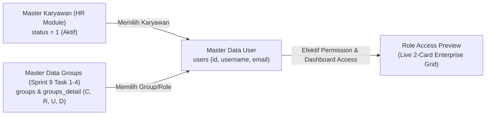

# IMPACT FURNITURE V2 — SPRINT 9 (TASK 5–9)
## MASTER DATA USER — ROLE & EMPLOYEE INTEGRATION ARCHITECTURE

### 1. Arsitektur Relasi Terintegrasi

Pada IMPACT FURNITURE V2, manajemen pengguna mengintegrasikan tiga pilar enterprise:

---

### 2. Form Layout & Dynamic Two-Card Preview

Sesuai pola antarmuka enterprise V2 dan screenshot sistem legacy:
- **Card Kiri (User Account Information)**:
  - Dropdown **Karyawan**: Menampilkan daftar karyawan aktif dari HR Master Data Karyawan.
  - Input **Nama Lengkap (`first_name`)**: Terisi otomatis saat memilih karyawan, namun tetap dapat disunting bila ada preferensi nama tampilan.
  - Input **Username**: Validasi real-time dengan debounce pencegahan duplikasi.
  - Input **Email**: Validasi format dan keunikan alamat email.
  - Dropdown **Groups/Role**: Memuat seluruh role terdaftar dari Master Data Groups (`groupService.getAllSync()`).
  - Input **Password** & **Konfirmasi Password**: Dilengkapi toggle visibility (`Show/Hide`) dan strength indicator.
  - Input **PIN Otorisasi Transaksi**: Input numerik 4-8 digit dengan toggle intip PIN.
  - Switch/Dropdown **Status**: Aktif (`1`) atau Non-Aktif (`0`).

- **Card Kanan (Role Access Preview Component — `UserRoleAccessPreview.vue`)**:
  - Diberi judul dinamis: *"Hak Akses Role: [NAMA GROUP]"*.
  - **KPI Metric Badges**: Menampilkan ringkasan hak akses:
    - Total Submenu Terotorisasi
    - Create Permitted (Hijau)
    - Read/Print Permitted (Biru)
    - Update Permitted (Kuning)
    - Delete Permitted (Merah)
    - Dashboard Widgets Aktif
  - **Dashboard & Chart Access Cards**: Menampilkan 3 kartu visual status widget:
    - *Widget 1: Grafik Penjualan Bulanan*
    - *Widget 2: Performa Pengadaan & Bahan Baku*
    - *Widget 3: Utilisasi Kapasitas Produksi*
  - **Submenu Permission Matrix Accordion**:
    - Dikelompokkan ke dalam 10 kategori modul enterprise (Pengadaan, Persediaan, Produksi, Distribusi, Penjualan, Keuangan & Akuntansi, Manajemen Aset, Sumber Daya Manusia, Pemeliharaan Mesin, dan Pengaturan Sistem).
    - Menampilkan tabel compact submenu dengan indikator visual checklist hijau (`✔`) untuk izin aktif dan tanda silang abu-abu (`✘`) untuk izin non-aktif.
    - Dilengkapi pencarian filter live untuk meninjau izin pada submenu tertentu.

---

### 3. Sinkronisasi Sesi Pengguna Aktif (`syncActiveUserSession`)

Ketika seorang pengguna mengubah role atau profil dari akun yang sedang digunakannya saat ini:
1. `userService.syncActiveUserSession(user)` mendeteksi apakah ID atau username sesuai dengan `authStore.currentUser`.
2. Jika terdeteksi sama, service mengambil detail permission terbaru dari `groupService.getById(user.groupId)`.
3. Fungsi `serializePermissionsToV2` memetakan flag CRUD legacy (`c`, `r`, `u`, `d`) ke format permission runtime V2 (`[resource]:create`, `[resource]:read`, `[resource]:update`, `[resource]:delete`).
4. Pinia `authStore.currentUser` dan route guard langsung terupdate secara real-time tanpa memerlukan refresh browser paksa.

---

### 4. Detail View (`look_page`)

Halaman Detail Pengguna (`UserDetailPage.vue`) merefleksikan spesifikasi legacy `look_page.php` dengan peningkatan visual modern:
- **Hero Banner**: Menampilkan avatar inisial, nama lengkap, username, status badge, dan tanggal registrasi/login.
- **Tabel 1 — Informasi Akun & Kredensial**:
  - Username
  - Email
  - Status PIN: Ditampilkan aman sebagai `"Sudah diset"` atau `"Belum diset"` (tidak pernah mengekspos digit PIN).
  - Terakhir Login & IP Address
- **Tabel 2 — Informasi Kepegawaian & Role**:
  - NIK Karyawan
  - Nama Karyawan Terpaut
  - Jabatan HR
  - Role ERP yang ditugaskan
- **Matriks Hak Akses Lengkap**: Memanfaatkan komponen `UserRoleAccessPreview` dalam mode read-only untuk audit menyeluruh izin operasional pengguna.
