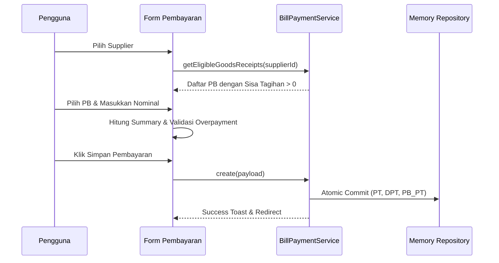

# Supplier Bill Payment Architecture

## Impact Furniture v2 ERP

---

### 1. Database Entity Architecture

Modul Pembayaran Tagihan Supplier memetakan 3 entitas utama MariaDB:

1. **`pembayaran_tagihan`**: Dokumen header bukti pembayaran yang menyimpan nomor invoice penagih, tanggal bayar, jatuh tempo, dan nominal total.
2. **`detail_pembayaran_tagihan`**: Rincian alokasi metode pembayaran (Transfer Bank dengan rekening tujuan, Tunai, atau Giro).
3. **`detail_pb_pt`**: Tabel persimpangan (junction) yang menautkan `penerimaan_barang_id` (`pb_id`) dengan `pembayaran_tagihan_id` (`pt_id`).

---

### 2. Payment Flow & Mathematical Formulas

```text
Nilai Tagihan Dokumen   = Σ Total PB Terpilih
Total Bayar Sebelumnya  = Σ Pembayaran Valid dari Dokumen Lain
Sisa Tagihan            = max(0, Nilai Tagihan Dokumen - Total Bayar Sebelumnya)
Nominal Pembayaran Ini  = Σ Rincian Metode Pembayaran
Sisa Tagihan Akhir      = Sisa Tagihan - Nominal Pembayaran Ini

Aturan Validasi:
1. Nominal Pembayaran Ini > 0
2. Nominal Pembayaran Ini <= Sisa Tagihan (Mencegah Overpayment)
3. Status Lunas (status = 1) jika Sisa Tagihan Akhir <= 0
```

---

### 3. Allocation Flow


